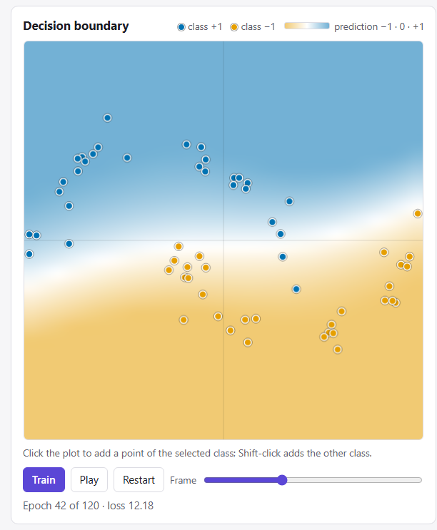
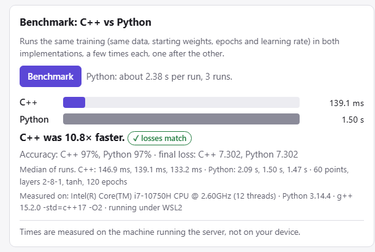

# micrograd-cpp: C++ vs Python autograd demo

A web demo built on a hand-written C++ port of Andrej Karpathy's
[micrograd](https://github.com/karpathy/micrograd), a scalar autograd engine with a tiny MLP.
You give it 2D points; the C++ engine trains a small neural network on them and the page animates
the decision boundary and the loss curve. A benchmark panel runs the same training in pure-Python
micrograd and checks that both reach the same loss.

**Live demo: <https://microgradcpp.vercel.app>.** It runs as a container on Vercel's shared 1-vCPU
functions, so its benchmark times differ from the [table below](#benchmark-results), which was measured
on the author's laptop. Each visitor can train once every 2 s and benchmark once every 15 s.



## Quick start

Prerequisites (Linux or WSL2):

- `g++` with C++17 support, and `make`
- `python3` with the `venv` module (on Debian/Ubuntu: the `python3-venv` package)
- internet access on the first run: `make` creates `project/.venv` and installs the pinned packages
  from `project/requirements.txt` (FastAPI, uvicorn, pydantic, pytest, httpx)
- optional: `node` >= 18, to run the frontend logic tests (`make test` skips them loudly without it)

```sh
cd project
make test     # builds the C++ CLI, runs the C++ self-checks, pytest and (if node is installed) node tests
make run      # serves the demo on http://127.0.0.1:8000
```

Open <http://127.0.0.1:8000>. The server binds to 127.0.0.1 only. On WSL2 the page also opens in a
Windows browser at the same address.

Other targets: `make asan` (debug build with AddressSanitizer/UBSan, runs the self-checks and the
CLI), `make bench` (benchmark table without the server), `make clean`.

## How it works

```
browser (project/web) --HTTP/JSON--> server.py (FastAPI, 127.0.0.1:8000)
                                       |-- subprocess --> build/micrograd_cli   (C++, -O2)
                                       |-- subprocess --> python/cli.py         (pure Python)
```

Both command-line programs read the same JSON request on stdin and write JSON on stdout, so the
server can run them on identical input. Each one times only its own training loop; process start-up,
JSON parsing and drawing frames are not timed. `POST /api/train` runs C++ only and returns up to
100 frames of the decision boundary for the animation; `POST /api/benchmark` runs both.

Training contract (identical in C++ and Python):

- Network `[2, hidden..., 1]`; a neuron computes `sum(w_i * x_i) + b`, then the activation
  (tanh, relu or sigmoid). The last layer is always linear.
- Loss is the **sum** over points of `(pred - label)^2`, labels -1 / +1.
- One epoch is full batch: forward every point, zero the grads, `backward()`, then
  `p.data -= lr * p.grad` for every parameter.
- The learning rate in the UI and the HTTP API is per data point; the server passes `lr / N` to both
  programs because the loss is a sum over N points.
- The server generates the starting weights (`init_weights`) from the seed and sends the same list
  to both implementations.
- Accuracy is measured after the last epoch: `pred >= 0` means +1.
- The tests require both implementations to reach the same final loss within a relative 1e-6.

Benchmark fairness rules:

- Same data, same starting weights, same epochs and learning rate for both; C++ built with `-O2`.
- C++ runs first, then Python, never at the same time, and only one benchmark runs at a time.
- 3 runs each, the median is reported along with every run; a Python run longer than 5 s is not
  repeated.
- Requests whose estimated Python time is over 15 s are refused up front (HTTP 422); a Python run
  that still exceeds 20 s is stopped and reported as a timeout, with no speedup.
- Times are measured on the machine running the server, not on the visitor's device.

## Benchmark results

Measured with `make bench` on the author's laptop:

- Intel Core i7-10750H @ 2.60GHz (12 threads)
- Ubuntu 26.04 LTS under WSL2 on Windows 11 (kernel 6.18.33.2-microsoft-standard-WSL2)
- Python 3.14.4; g++ 15.2.0 with `-std=c++17 -O2`

All configs use tanh, a per-point learning rate of 0.1, starting weights from seed 1 and moons data.
The table was run twice on an otherwise idle machine. The speedup column shows the lower of the two
runs, with the range in brackets; the time columns show the median of each run.

| config | data | layers | params | epochs | C++ median (s) | Python median (s) | speedup (range) | losses match |
|---|---|---|---|---|---|---|---|---|
| small | 30 moons points | 2-4-1 | 17 | 300 | 0.085 / 0.084 | 1.006 / 1.011 | **11.8x** (11.8-12.0x) | yes |
| default | 60 moons points | 2-8-1 | 33 | 120 | 0.119 / 0.127 | 1.496 / 1.478 | **11.6x** (11.6-12.5x) | yes |
| large | 100 moons points | 2-8-8-1 | 105 | 100 | 0.558 / 0.549 | 7.318 / 7.028 | **12.8x** (12.8-13.1x) | yes |

Each C++ time is the median of 3 runs. The small and default Python times are also medians of 3 runs.
In the large config a Python run takes more than 5 s, so it is not repeated: each of its Python times is a
single run. "Losses match" means both implementations reached the same final loss within a relative 1e-6.



*An example single run from the web UI with the default settings. Its numbers can differ slightly from the
table, because each press of the button is a separate measurement.*

What these numbers do and don't say:

- Both sides are straight, unoptimized scalar ports of the same algorithm; neither was tuned for speed.
- The C++ side is bound by allocating one graph node (a `shared_ptr` plus a closure) per arithmetic
  operation, not by the arithmetic itself.
- The times belong to the machine running the server. Other machines will give other numbers.
- Comparisons with NumPy or PyTorch are out of scope.
- Scalar autograd is not how real deep learning runs; frameworks work on whole tensors at once.

## Notes and limitations

- **Dead ReLU.** With relu, some starting weights give a network whose hidden units never activate,
  so the output stays flat and nothing is learned. **Re-initialize** picks a new random seed and
  trains again.
- **One run at a time.** The server runs one training or benchmark at a time; a request that arrives
  while another is running gets HTTP 409 and the page shows the server's message.
- **Limits** (enforced by the server, shown in the UI from `GET /api/limits`): 400 points,
  2000 epochs, 4 hidden layers of 1-32 neurons, per-point learning rate up to 0.3, 100 animation frames,
  timeouts of 10 s (C++) and 20 s (Python).
- The point limit is there because `backward()` builds its topological order recursively and the
  graph gets deeper with every point.
- Scalar autograd builds one graph node per arithmetic operation. It is a teaching tool, not how
  real deep-learning frameworks compute.

## Repository layout

```
micrograd.cpp          the original hand-written C++ port (the starting point; unchanged)
project/               the demo
  cpp/                 micrograd.hpp (header-only engine), main.cpp (CLI), third_party/json.hpp
  python/              micrograd.py (pure-Python port), cli.py, server.py, bench.py
  web/                 index.html, style.css, app.js (UI), data.js (pure logic)
  tests/               self_test.cpp, test_equivalence.py, test_server.py, data.test.js
  reference/           micrograd_extended.cpp, the single-file reference the header follows
  data/                moons_sample.csv (60 points; load it with "Open file..." in the UI)
  Makefile, requirements.txt
docs/                  screenshots for this README
```

## Credits

The C++ engine is the author's port of Andrej Karpathy's micrograd
([github.com/karpathy/micrograd](https://github.com/karpathy/micrograd)), written while following his
lecture on backpropagation; the demo around it (CLI, server, web UI, tests) was built with Claude Code
assistance.

JSON parsing in the C++ CLI uses [JSON for Modern C++](https://github.com/nlohmann/json) by Niels Lohmann,
vendored as a single header.

## Licence

MIT, see [LICENSE](LICENSE). Third-party licence notices are in
[THIRD_PARTY_NOTICES.md](THIRD_PARTY_NOTICES.md).
